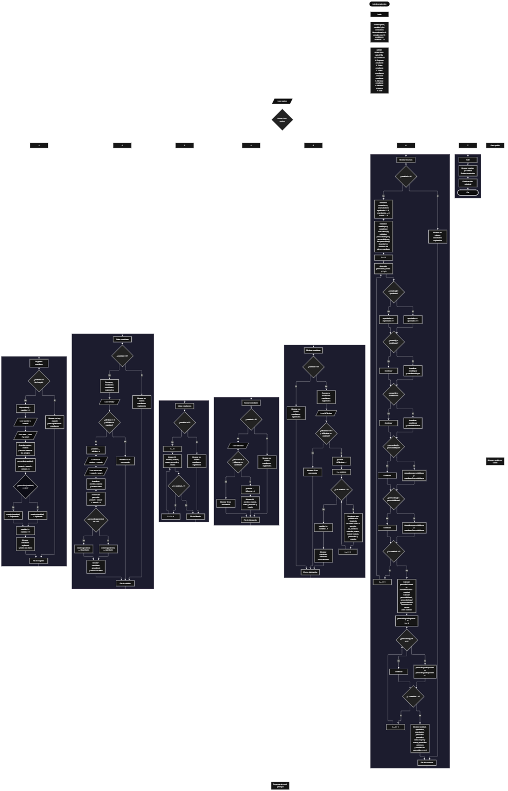

Este proyecto, llamado <b>boletín académico</b>, fue desarrollado en <b>visual basic .net</b> como un ejercicio práctico para fortalecer la lógica de programación mediante la creación de un sistema de gestión de estudiantes y sus calificaciones desde la consola. El programa cuenta con un menú principal de siete opciones que permite <b>registrar, editar, eliminar, buscar, listar y consultar estadísticas</b> de los estudiantes registrados. Cada estudiante almacena información como su nombre, materia y tres calificaciones, además de su promedio y estado académico, utilizando arreglos con una capacidad máxima de <b>10 estudiantes durante la ejecución</b>. El sistema calcula automáticamente el promedio de las tres notas y determina si el estudiante está aprobado o reprobado, considerando una calificación mínima de <b>3.0</b> para aprobar. Durante su desarrollo se aplicaron conceptos fundamentales de programación, como variables, arreglos, estructuras condicionales, ciclos repetitivos y estructuras de selección, además de procesos para buscar, modificar, eliminar y reorganizar registros. Este proyecto permite poner en práctica los conocimientos adquiridos en Visual Basic .NET y sirve como base para desarrollar sistemas académicos más completos.

<h2 align="center">⚙️ Funcionamiento del menú principal</h2>

### ➕ Registrar estudiante

La opción <b>1) registrar estudiante</b> permite incorporar un nuevo estudiante al sistema académico. Antes de realizar el registro, el programa comprueba que la cantidad de estudiantes almacenados sea menor que la capacidad máxima de los arreglos mediante la condición <b>cantidad &gt;= ids.Length</b>. Si existe espacio disponible, asigna un identificador consecutivo utilizando la expresión <b>cantidad + 1</b> y solicita el <b>nombre del estudiante, la materia y las tres calificaciones</b>. Los datos se almacenan en la posición correspondiente de sus respectivos arreglos. Posteriormente, calcula el promedio mediante la suma de las tres notas dividida entre tres y determina el estado académico utilizando una estructura condicional: si el promedio es igual o superior a <b>3.0</b>, el estudiante queda como <b>"Aprobado"</b>; de lo contrario, queda como <b>"Reprobado"</b>. Finalmente, aumenta la variable <b>cantidad</b> en uno y muestra todos los datos del estudiante registrado. Si los arreglos alcanzan su capacidad máxima de 10 estudiantes, presenta el mensaje <b>"no hay espacio para registrar mas estudiantes."</b>, impidiendo agregar otro registro.

### ✏️ Editar estudiante

La opción <b>2) editar estudiante</b> permite modificar la información académica de un estudiante registrado. Primero, el programa comprueba si existen estudiantes almacenados mediante la variable <b>cantidad</b>. Si no hay registros, muestra el mensaje <b>"no existen estudiantes registrados."</b>. En caso contrario, presenta una lista con el ID, nombre, materia, tres calificaciones, promedio y estado académico de cada estudiante. Después, solicita el ID del estudiante que se desea editar y comprueba que se encuentre dentro del rango permitido mediante la condición <b>idEditar &gt;= 1 And idEditar &lt;= cantidad</b>. Si la selección es válida, calcula su posición utilizando <b>idEditar - 1</b> y solicita el nuevo nombre, materia y las tres calificaciones. Los datos se actualizan directamente en los arreglos correspondientes. Posteriormente, recalcula el promedio y determina nuevamente el estado académico, utilizando la calificación mínima de <b>3.0</b> para aprobar. Finalmente, muestra el mensaje <b>"estudiante actualizado correctamente."</b> y presenta la información actualizada. Si el ID seleccionado no se encuentra dentro del rango permitido, muestra el mensaje <b>"ID no encontrada."</b>.

### 📋 Listar estudiantes

La opción <b>3) listar estudiantes</b> permite visualizar todos los estudiantes registrados actualmente en el sistema. Antes de mostrar la información, el programa comprueba si la variable <b>cantidad</b> es igual a cero. Si no existen registros, presenta el mensaje <b>"no existen estudiantes registrados."</b>. Si hay estudiantes disponibles, utiliza un ciclo <b>For</b> para recorrer los arreglos desde la primera posición hasta la cantidad total de estudiantes registrados. Durante el recorrido, muestra el ID, nombre, materia, primera nota, segunda nota, tercera nota, promedio y estado académico de cada estudiante. Esta función facilita consultar las calificaciones y el rendimiento académico de todos los estudiantes sin necesidad de buscarlos individualmente.

### 🔎 Buscar estudiante

La opción <b>4) buscar estudiante</b> permite localizar un estudiante mediante su identificador. Primero, el programa comprueba si existen estudiantes registrados. Si el sistema está vacío, muestra el mensaje <b>"no existen estudiantes registrados."</b>. En caso contrario, solicita el ID del estudiante que se desea buscar y verifica que se encuentre dentro del rango permitido mediante la condición <b>idBuscar &gt;= 1 And idBuscar &lt;= cantidad</b>. Si el ID es válido, calcula la posición correspondiente utilizando <b>idBuscar - 1</b> y muestra todos los datos del estudiante: nombre, materia, las tres calificaciones, promedio y estado académico. Si el identificador introducido no corresponde a un estudiante registrado, presenta el mensaje <b>"ID no encontrada."</b>. Esta operación permite consultar directamente la información académica de un estudiante mediante su identificador.

### 🗑️ Eliminar estudiante

La opción <b>5) eliminar estudiante</b> permite eliminar un estudiante registrado mediante su identificador. Antes de comenzar, el programa comprueba que existan estudiantes almacenados. Si no hay registros, muestra el mensaje <b>"no existen estudiantes registrados."</b>. Si hay estudiantes disponibles, presenta una lista con sus respectivos datos para facilitar la selección. Después, solicita el ID del estudiante que se desea eliminar y comprueba que se encuentre dentro del rango válido. Si el identificador existe, calcula su posición mediante <b>idEliminar - 1</b> y comienza el proceso de eliminación. Para mantener los registros organizados, utiliza un ciclo <b>For</b> que desplaza una posición hacia la izquierda los datos de los estudiantes posteriores en los ocho arreglos: <b>ids, nombres, materias, notas1, notas2, notas3, promedios y estados</b>. Posteriormente, disminuye la variable <b>cantidad</b> en uno y muestra el mensaje <b>"estudiante eliminado correctamente."</b>. De esta manera, los registros restantes conservan su correspondencia dentro de los arreglos y no quedan espacios vacíos entre los estudiantes activos. Si el ID seleccionado no corresponde a un estudiante registrado, presenta el mensaje <b>"ID no encontrada."</b>.

### 📊 Mostrar resumen

La opción <b>6) mostrar resumen</b> permite consultar estadísticas generales sobre el rendimiento académico de los estudiantes registrados. Primero, el programa comprueba si existen estudiantes almacenados. Si no hay registros, muestra el mensaje <b>"no existen estudiantes registrados."</b>. En caso contrario, inicializa diferentes contadores y acumuladores para calcular la información académica. Mediante un primer ciclo <b>For</b>, suma los promedios y las tres calificaciones de todos los estudiantes, cuenta la cantidad de aprobados y reprobados, identifica la nota más alta y más baja de la primera evaluación y determina el promedio más alto y más bajo, conservando los nombres de los estudiantes correspondientes. Para establecer estos valores, utiliza variables inicializadas con los datos del primer estudiante registrado. Después, calcula el <b>promedio general</b> y los promedios individuales de cada evaluación dividiendo sus respectivas sumas entre la cantidad de estudiantes. Finalmente, utiliza un segundo ciclo <b>For</b> para contar los estudiantes cuyos promedios sean iguales o superiores a <b>4.0</b>. El resultado muestra la cantidad de estudiantes, aprobados, reprobados, promedios generales, notas extremas y estudiantes destacados según sus calificaciones.

### 🚪 Salir del menú principal

La opción <b>7) salir</b> permite finalizar la ejecución del sistema académico y muestra el mensaje <b>"gracias por utilizar Boletin Academico."</b>. El menú principal se encuentra dentro de una estructura repetitiva <b>Do...Loop While</b>, que mantiene el programa en funcionamiento mientras la variable <b>opcion</b> sea diferente de <b>7</b>. Cuando el usuario selecciona esta opción, se ejecuta el mensaje de despedida y la condición del ciclo permite finalizar el programa.

<h2 align="center">🧠 Temas aplicados en el proyecto</h2>

### 📦 Variables

En este proyecto se utilizan variables para controlar la cantidad de estudiantes registrados, almacenar la opción seleccionada en el menú, identificar los registros que se desean editar, buscar o eliminar, calcular los promedios y las estadísticas académicas, además de determinar el rendimiento de cada estudiante. Cada variable cumple una función específica dentro de las operaciones del sistema.

🔢 **Ids:** Almacena los identificadores consecutivos de los estudiantes registrados.

👤 **Nombres:** Permite almacenar los nombres de los estudiantes.

📚 **Materias:** Guarda las materias correspondientes a cada estudiante.

📝 **Notas1, Notas2 y Notas3:** Almacenan las tres calificaciones de cada estudiante.

📊 **Promedios:** Guarda el resultado del promedio de las tres calificaciones.

✅ **Estados:** Almacena la condición académica de cada estudiante, indicando si está aprobado o reprobado.

📌 **Cantidad:** Controla el número actual de estudiantes registrados.

⚙️ **Opcion:** Almacena la opción seleccionada por el usuario en el menú principal.

🔎 **IdEditar, IdBuscar e IdEliminar:** Almacenan los identificadores introducidos para realizar las operaciones correspondientes.

📍 **Posicion:** Permite obtener el índice del arreglo correspondiente al identificador seleccionado.

📈 **Aprobados y Reprobados:** Cuentan la cantidad de estudiantes según su estado académico.

➕ **SumaPromedios, SumaNota1, SumaNota2 y SumaNota3:** Acumulan los valores necesarios para calcular los promedios generales y de cada evaluación.

🏆 **NotaMayor, NotaMenor, PromedioMayor y PromedioMenor:** Almacenan los valores máximos y mínimos utilizados en las estadísticas académicas.

👤 **EstudianteMayor, EstudianteMenor, EstudiantePromedioMayor y EstudiantePromedioMenor:** Guardan los nombres de los estudiantes asociados a las calificaciones y promedios extremos.

🔢 **PromedioIgualSuperior4:** Cuenta los estudiantes que tienen un promedio igual o superior a 4.0.

### 🗃️ Arreglos

En este proyecto se utilizan ocho arreglos paralelos, cada uno con una capacidad de <b>10 posiciones</b>. Todos comparten el mismo índice para representar la información correspondiente a un mismo estudiante. Por ejemplo, los datos almacenados en la posición <b>0</b> de los arreglos representan al mismo estudiante. Esta organización permite registrar, consultar, modificar, eliminar y calcular estadísticas académicas manteniendo relacionados los datos de cada registro.

🆔 **Ids(10):** Almacena los identificadores de los estudiantes.

👤 **Nombres(10):** Almacena los nombres de los estudiantes.

📚 **Materias(10):** Almacena las materias de cada estudiante.

📝 **Notas1(10):** Almacena las calificaciones de la primera evaluación.

📝 **Notas2(10):** Almacena las calificaciones de la segunda evaluación.

📝 **Notas3(10):** Almacena las calificaciones de la tercera evaluación.

📊 **Promedios(10):** Almacena los promedios calculados a partir de las tres calificaciones.

✅ **Estados(10):** Almacena el estado académico de cada estudiante.

### 🔀 Estructuras condicionales

En este proyecto se utilizan las estructuras <b>If...Then...Else</b> para comprobar si existen estudiantes registrados, verificar si los arreglos tienen espacio disponible, validar los identificadores introducidos por el usuario y determinar el estado académico de cada estudiante. También se utilizan para comparar las notas y los promedios, identificar sus valores mayores y menores y contar a los estudiantes que alcanzan un promedio igual o superior a 4.0. Estas condiciones permiten que el programa ejecute diferentes instrucciones según los resultados de cada comprobación.

### 🔄 Estructuras repetitivas

En este proyecto se utilizan los ciclos <b>Do...Loop While</b> y <b>For</b>. El ciclo <b>Do...Loop While</b> mantiene activo el menú principal y permite ejecutar las diferentes operaciones hasta que el usuario selecciona la opción 7. Por otro lado, los ciclos <b>For</b> permiten recorrer los arreglos para listar estudiantes, mostrar los registros antes de editarlos o eliminarlos, desplazar los datos durante la eliminación y realizar los cálculos estadísticos del resumen académico.

### 🎯 Estructura de selección

El programa utiliza la estructura <b>Select Case</b> para evaluar el valor almacenado en la variable <b>opcion</b> y ejecutar el bloque de instrucciones correspondiente. Cada caso representa una operación específica del sistema: <b>registrar, editar, listar, buscar, eliminar, mostrar resumen o salir</b>. También se utiliza el bloque <b>Case Else</b> para mostrar el mensaje <b>"Opcion no valida."</b> cuando el usuario introduce un número que no corresponde a ninguna de las opciones definidas en el menú.

### 🔢 Dimensionamiento de arreglos

El programa utiliza la declaración de arreglos con el límite <b>(9)</b>, lo que permite disponer de <b>10 posiciones</b> en cada uno, comprendidas entre los índices <b>0 y 9</b>. Esta capacidad permite almacenar hasta 10 estudiantes durante la ejecución. La variable <b>cantidad</b> controla el número de registros ocupados y se utiliza para determinar las posiciones disponibles y limitar los recorridos a los estudiantes registrados.

### 🔄 Reorganización de registros

Cuando se elimina un estudiante, el programa utiliza un ciclo <b>For</b> que comienza en la posición seleccionada y llega hasta <b>cantidad - 2</b>. En cada repetición, copia los datos de la posición siguiente sobre la posición actual en los ocho arreglos paralelos. De esta manera, los datos del estudiante siguiente ocupan el espacio del estudiante eliminado y los demás registros se desplazan una posición hacia la izquierda. Finalmente, la variable <b>cantidad</b> disminuye en uno para actualizar el número de estudiantes registrados. Esta reorganización permite mantener los registros activos consecutivos dentro de los arreglos.

### 📐 Cálculo de promedios y estadísticas

El sistema aplica operaciones aritméticas para calcular el promedio individual de cada estudiante mediante la suma de sus tres calificaciones dividida entre tres. También utiliza acumuladores para sumar los promedios y las notas de cada evaluación, lo que permite obtener el promedio general y los promedios individuales de las tres notas. Además, mediante comparaciones identifica la nota mayor y menor de la primera evaluación, así como el promedio más alto y más bajo, guardando los nombres de los estudiantes correspondientes. Finalmente, utiliza contadores para determinar la cantidad de aprobados, reprobados y estudiantes con promedios iguales o superiores a 4.0.

<h2 align="center">¿Cómo se implementaron las operaciones crud en el proyecto?</h2>

Las operaciones <b>crud</b> se implementaron mediante las opciones del menú principal, permitiendo administrar la información académica de los estudiantes. La operación <b>crear</b> corresponde a <b>registrar estudiante</b>, donde se almacenan los datos personales y las calificaciones de un nuevo estudiante; <b>leer</b> se realiza mediante las opciones <b>buscar estudiante, listar estudiantes y mostrar resumen</b>, que permiten consultar los registros y sus estadísticas; <b>actualizar</b> corresponde a <b>editar estudiante</b>, donde se modifican los datos y se recalcula automáticamente el promedio y el estado académico; y <b>eliminar</b> se realiza mediante la opción <b>eliminar estudiante</b>, que desplaza los registros posteriores para mantener organizados los arreglos. Estas operaciones utilizan variables, arreglos, condicionales y ciclos para administrar la información almacenada temporalmente durante la ejecución del programa.

<h2 align="center">Diagrama de flujo del proyecto</h2>

<h2 align="center">🛡️ Validaciones del programa</h2>

### 📭 No existen estudiantes registrados

Esta validación se utiliza en las opciones de <b>editar, listar, buscar, eliminar y mostrar resumen</b>. El programa comprueba si la variable <b>cantidad</b> es igual a <b>0</b> y, si no existen estudiantes registrados, muestra el mensaje <b>"No existen estudiantes registrados."</b>. Esta comprobación evita continuar con operaciones que necesitan información almacenada cuando el sistema académico está vacío.

### ⚠️ Capacidad máxima alcanzada

Esta validación se utiliza durante el registro de nuevos estudiantes para controlar la capacidad máxima de los arreglos. El programa comprueba si <b>cantidad &gt;= ids.Length</b> antes de permitir agregar un nuevo registro. Como los arreglos tienen una capacidad de <b>10 estudiantes</b>, si se alcanza ese límite, muestra el mensaje <b>"No hay espacio para registrar mas estudiantes."</b>, impidiendo agregar más registros.

### ❌ ID no encontrada

Esta validación se utiliza durante las operaciones de <b>editar, buscar y eliminar estudiantes</b>. El programa comprueba que el identificador introducido sea mayor o igual a <b>1</b> y menor o igual a la cantidad actual de estudiantes mediante las condiciones correspondientes. Si el ID se encuentra dentro del rango permitido, calcula la posición del estudiante utilizando la expresión <b>ID - 1</b> y ejecuta la operación solicitada. En caso contrario, muestra el mensaje <b>"ID no encontrada."</b>, evitando acceder a una posición que no corresponde a un registro activo.

### 📊 Determinación del estado académico

Esta validación se utiliza durante el registro y la edición de estudiantes para determinar si han aprobado o reprobado una materia. El programa comprueba si el promedio de las tres calificaciones es igual o superior a <b>3.0</b>. Si se cumple esta condición, almacena el estado <b>"Aprobado"</b>; de lo contrario, registra <b>"Reprobado"</b>. Cuando se modifican las calificaciones, el promedio y el estado académico se calculan nuevamente para mantener actualizada la información del estudiante.

### 🔢 Promedios iguales o superiores a 4.0

Esta validación se utiliza en la opción <b>mostrar resumen</b> para identificar a los estudiantes que alcanzan un promedio destacado. Mediante un segundo ciclo <b>For</b>, el programa recorre los promedios registrados y comprueba si cada uno es igual o superior a <b>4.0</b>. Cuando se cumple la condición, aumenta en uno la variable <b>promedioIgualSuperior4</b>. Finalmente, muestra la cantidad de estudiantes que cumplen con este criterio académico.

### ⚠️ Opción inválida

La estructura <b>Select Case</b> incluye el bloque <b>Case Else</b>, que muestra el mensaje <b>"Opcion no valida."</b> cuando el usuario introduce un número que no corresponde a ninguna de las opciones definidas en el menú principal. Esta comprobación permite informar al usuario cuando selecciona una operación inexistente.

### ⚠️ Entrada de datos no válida

El programa utiliza las instrucciones <b>Convert.ToInt32</b> y <b>Convert.ToDouble</b> para convertir los datos introducidos por el usuario en valores numéricos. Sin embargo, el código actual no incluye un control de excepciones para entradas vacías o valores que no sean numéricos. Tampoco comprueba que las calificaciones estén dentro de un rango académico permitido. Por lo tanto, estas situaciones pueden provocar errores durante la ejecución y requieren validaciones adicionales para fortalecer el funcionamiento del sistema.

### 🆔 Identificadores después de eliminar estudiantes

El programa utiliza los identificadores para seleccionar los registros mediante su posición, calculada con la expresión <b>ID - 1</b>. Durante la eliminación, los datos de los arreglos se desplazan hacia la izquierda, pero los identificadores no se vuelven a generar ni actualizar. Por este motivo, los ID pueden quedar desordenados o presentar saltos en la numeración, lo que puede provocar que una búsqueda, edición o eliminación posterior no corresponda al estudiante esperado. Esta consideración debe tenerse en cuenta al utilizar el sistema después de eliminar registros.

<h2 align="center">🎯 Objetivo del proyecto</h2>

El objetivo principal de este proyecto es fortalecer la <b>lógica de programación</b> mediante el desarrollo de un sistema de gestión de boletines académicos en <b>visual basic .net</b>. A través de su construcción se busca aplicar los conocimientos adquiridos sobre variables, arreglos, estructuras condicionales, ciclos repetitivos y estructuras de selección, integrándolos para administrar estudiantes y sus calificaciones de manera organizada. Además, el proyecto permite comprender cómo registrar, consultar, modificar y eliminar información, calcular promedios, determinar estados académicos y generar estadísticas sobre el rendimiento estudiantil, estableciendo una base para desarrollar sistemas académicos más completos.

